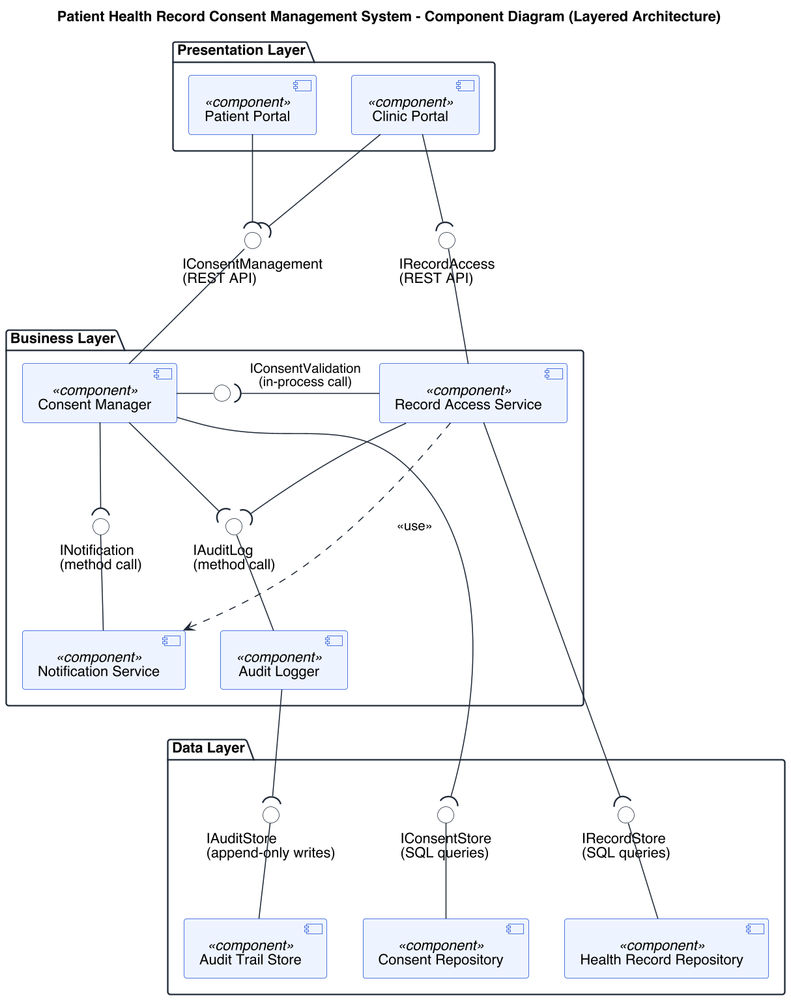

# Lab 3: Component Modelling & Architectural Pattern Selection

**System:** Patient Health Record Consent Management System (Problem Statement #13)

**Name:** Mohammed Tahir Siddique | **SRN:** PES2UG24AM092

## Deliverables

| # | Deliverable | Files |
|---|-------------|-------|
| 1 | UML Component Diagram | [component-diagram.png](component-diagram.png), [component-diagram.puml](component-diagram.puml) |
| 2 | Written Justification (1 page) | [justification.pdf](justification.pdf), [justification.docx](justification.docx), [justification.md](justification.md) |

## Step 1: Scenario Review

A patient-centric health data gateway where patients manage granular, time-bound consent for clinics to access their medical history. The requirements come from [Lab 1](../lab-1/requirements.md).

| Area | Key points |
|------|------------|
| Functional | Grant and revoke time-bound consent, clinic access requests with patient approval, consent check on every record access, consent and access history for the patient. |
| Non-functional | Append-only audit trail for every grant, revoke and access event. Consent validation within 500 ms for 95% of requests. |
| Main challenges | **Security:** no record may be released without a valid consent. **Consistency:** a revocation or expiry must take effect immediately. **Performance:** consent checks happen during consultations and must be fast. |

## Step 2: Architectural Style Analysis

| Style | Pros for this system | Cons for this system |
|-------|----------------------|----------------------|
| Layered | Consent rules sit in one Business Layer that every request passes through. The Data Layer is hidden from the portals. Simple to build and test for a small system. | Layers cannot be scaled separately. A change in a lower layer can affect the layers above it. |
| Microservices | Consent, record access and audit could scale and fail independently. | Consent, expiry and audit data would be split across services, which makes immediate revocation and consistent auditing harder. Every consent check becomes a network call. High operational effort for a small system. |
| Client-Server | Central server keeps all consent data consistent. Simple deployment. | Describes only the client and server split, with no separation of user interface, consent rules and storage inside the server. Single point of failure. |

## Step 3: Architecture Selection & Components

**Selected style: Layered Architecture.** The reasons are in the [written justification](justification.pdf).

| Layer | Component | Responsibility |
|-------|-----------|----------------|
| Presentation | Patient Portal | Screens for granting, revoking and reviewing consents and viewing access history. |
| Presentation | Clinic Portal | Screens for submitting access requests and viewing consented records. |
| Business | Consent Manager | Creates, revokes and expires consents, and answers consent validation checks. |
| Business | Record Access Service | Releases records to a clinic only after a successful consent validation. |
| Business | Notification Service | Sends alerts to patients and clinic administrators. |
| Business | Audit Logger | Records every grant, revoke and access event. |
| Data | Consent Repository | Stores consents and access requests. |
| Data | Health Record Repository | Stores patient health records. |
| Data | Audit Trail Store | Append-only storage for audit entries. |

## Step 4: Component Diagram

### Interfaces

| Interface | Provided by | Required by | Technology | Purpose |
|-----------|-------------|-------------|------------|---------|
| IConsentManagement | Consent Manager | Patient Portal, Clinic Portal | REST API | Grant, revoke and review consents; submit access requests. |
| IRecordAccess | Record Access Service | Clinic Portal | REST API | Request consented health records. |
| IConsentValidation | Consent Manager | Record Access Service | In-process call | Check that an active consent covers the requested record. |
| INotification | Notification Service | Consent Manager | Method call | Notify patient and clinic of consent events. |
| IAuditLog | Audit Logger | Consent Manager, Record Access Service | Method call | Record grant, revoke and access events. |
| IConsentStore | Consent Repository | Consent Manager | SQL queries | Read and write consents. |
| IRecordStore | Health Record Repository | Record Access Service | SQL queries | Read health records. |
| IAuditStore | Audit Trail Store | Audit Logger | Append-only writes | Persist audit entries. |

The Record Access Service also has a `<<use>>` dependency on the Notification Service, to alert the patient when an access attempt is denied.

**Notation:** a circle (ball) is a provided interface and a half-circle (socket) is a required interface. The diagram is generated from [component-diagram.puml](component-diagram.puml) using PlantUML.
